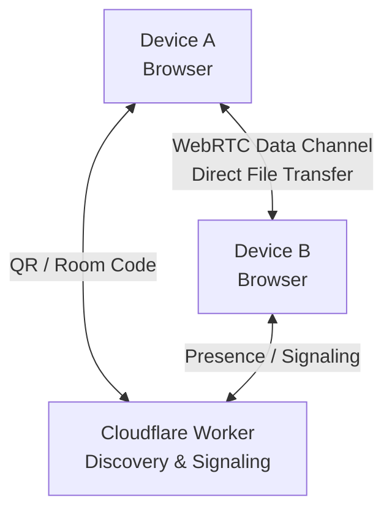

# AirLocal

### AirDrop for every device. No app required.

**AirLocal** is a browser-based, peer-to-peer file transfer application that lets you move files between Android, iPhone, Windows, macOS, and Linux using nothing but a modern web browser.

No cables. No account. No dedicated app. No cloud file uploads.

Open AirLocal on two devices, pair them using a QR code or room code, and transfer files directly between their browsers over your local network.

<p align="center">
  <a href="https://airlocal.online/"><strong>Try AirLocal →</strong></a>
  &nbsp;·&nbsp;
  <a href="https://github.com/pulkitpareek18/AirLocal">Source Code</a>
  &nbsp;·&nbsp;
  <a href="https://github.com/pulkitpareek18/AirLocal/issues">Report an Issue</a>
</p>

<p align="center">
  
  
  
</p>

---


## See AirLocal in Action

Click the preview below to explore the interactive walkthrough.

[](https://app.arcade.software/share/MqtQuSzwEQc2LtmulW95)


## The idea

Sharing a file between your phone and laptop should be as simple as sharing it between two devices in the same ecosystem.

But transferring a photo from Android to a Mac, a document from an iPhone to a Windows PC, or a video from a laptop to another device can involve cables, extra applications, messaging platforms, or cloud storage.

AirLocal brings that simplicity to the open web.

It uses browser-native technologies to make cross-device file sharing accessible from practically any device with a compatible browser. Instead of uploading files to a central service and downloading them again, AirLocal establishes a peer-to-peer connection between the devices.

**One browser. Two devices. A direct transfer.**

## Why AirLocal?

| Traditional file sharing | AirLocal |
| --- | --- |
| Often requires installing an application | Works in a browser |
| May require an account | No account required |
| May upload files to cloud storage | File data travels peer-to-peer |
| Ecosystem-specific sharing tools | Cross-platform browser access |
| Can require cables or external drives | Wireless transfer over a local network |

## Features

### Cross-platform by design

Transfer files between Android, iOS, Windows, macOS, and Linux using compatible modern browsers. The receiving device doesn't need a dedicated AirLocal application.

### Direct peer-to-peer transfers

AirLocal uses WebRTC data channels to transfer file data directly between connected browsers. Its signaling relay helps establish the connection but does not receive or store the file contents.

### QR code and room-code pairing

Connect devices using a scannable QR code or a shared four-digit room code. Device names and platform indicators help identify participants.

### Local-network transfers

Designed for devices connected to the same Wi-Fi network, phone hotspot, or LAN/Ethernet network. File data travels over the local network rather than through a cloud file-storage service.

### Built for practical transfers

- Multiple files in a transfer queue
- Chunked file streaming
- Real-time transfer progress, speed, and estimated time remaining
- Cancellation from the sender or receiver
- Backpressure handling to help manage memory consumption
- Large-file staging using the Origin Private File System (OPFS), where supported

### Flexible file saving

- Save to the browser's Downloads location as a fallback
- Select a destination folder in supported browsers
- Organize files by type
- Handle duplicate filenames with Replace, Keep Both, Skip, or Replace All
- Optional backup mode with configurable date and time-based folder names

### In-app file previews

Preview received or queued files directly in the app: images, videos, audio, PDFs, and text or source files under the preview size limit. Previews open in a modal, use the browser's built-in viewers, and can be opened in a new tab. Large and unsupported files keep their normal transfer flow.

### Copy to clipboard

Received images and text files can be copied to the system clipboard straight from the transfer card or the preview dialog. Non-PNG images are converted automatically where the browser supports it. The button briefly turns into a green check mark when the copy succeeds.

### Keyboard-first operation

The whole app can be driven from the keyboard, in the spirit of tools like monkeytype:

- `?` — open the command palette (search and run any action)
- `Ctrl/Cmd + K` — open the command palette from anywhere, even while typing
- `Shift + 1`–`9` — connect to the n-th nearby device
- `o` — choose files to send
- `s` — send the staged queue
- `d` — disconnect
- `c` — settings
- `n` — rename this device
- `r` — change room code
- `f` — choose save folder
- `t` — toggle light/dark theme
- `Esc` — close dialogs, `Enter` — confirm
- Dialog shortcuts while a modal is open: `↵` accept/confirm, `Esc` decline/cancel, `s`/`k`/`r`/`a` Skip/Keep/Replace/Replace-all on duplicate files, `c`/`n` copy/open-in-new-tab in previews

Single-key shortcuts are ignored while typing in an input. Nearby device cards show their Shift + number key. Every dialog puts keyboard focus on its primary action when it opens, so `Tab`, `Enter`, and `Esc` are enough to operate the whole app.

### No cloud file storage

AirLocal does not upload file contents to a central storage service. Connection signaling and device discovery are handled separately from the actual file transfer.

---

## How it works

AirLocal separates device discovery from file transport.



1. **Open AirLocal** on both devices.
2. **Connect to the same local network** using Wi-Fi, a phone hotspot, or LAN/Ethernet.
3. **Pair the devices** by scanning a QR code or entering the same room code.
4. **Establish the connection** through the signaling relay.
5. **Transfer files directly** between the connected browsers using WebRTC.
6. **Save received files** using the available browser download or folder-access capabilities.

The Cloudflare Worker supports discovery, presence, and signaling. File contents are transferred over the peer-to-peer connection, not through the signaling relay.

### Why WebRTC?

WebRTC provides browser-native peer-to-peer communication without requiring users to install a native client. Its data channels support sending arbitrary binary data, making them suitable for file transfer.

This architecture keeps the application lightweight and avoids routing file contents through a central application server.

---

## Privacy and security

AirLocal is designed around a simple principle: **the infrastructure used to connect devices should not need to store the files being transferred.**

- **No file-storage backend:** AirLocal does not use a central cloud storage service for transferred files.
- **Peer-to-peer transport:** File contents travel over the WebRTC connection between connected browsers.
- **Encrypted transport:** WebRTC data channels provide encrypted transport.
- **No account required:** Pairing does not require a user account.
- **Local-first networking:** Transfers are designed to use the devices' shared local network.

### Important security considerations

- Room codes are discovery identifiers, not passwords. Anyone who knows a room code may be able to discover devices in that room.
- Use a fresh room code for sensitive sharing sessions and verify the receiving device before accepting a connection.
- Browser permissions, network configuration, and the signaling service remain part of the overall security model.
- A peer-to-peer connection does not guarantee that every aspect of a session is private or that every transfer will remain entirely on the local network under every network configuration.

AirLocal is designed for direct file transfer, but users should still verify the destination and avoid sharing sensitive files with untrusted devices.

---

## Network requirements and limitations

AirLocal is designed for **local-network file sharing**, not unrestricted transfers between arbitrary networks.

- Both devices should be connected to the same Wi-Fi network, phone hotspot, or LAN/Ethernet network.
- File transfer is intended to use the local network, not mobile data.
- Both devices must have AirLocal open and available during the transfer.
- Some routers, client-isolation settings, managed networks, and browser configurations may prevent a connection.
- Internet access may be required for the hosted application and connection-signaling service, depending on the deployment.
- Browser support for custom destination folders and OPFS varies. AirLocal falls back to standard browser downloads where possible.
- Actual transfer speed and maximum practical file size depend on the network, browser, available storage, and device resources.

The application prompts for confirmation before unusually large operations, including transfers involving more than 100 files, more than 25 GB in total, or a single file larger than 10 GB. These are confirmation thresholds, not guaranteed transfer limits.

---

## Technology stack

AirLocal uses modern web technologies to provide a native-app-like file-sharing experience without requiring a native application.

| Technology | Purpose |
| --- | --- |
| React 19 | Component-based user interface |
| TypeScript | Type safety and maintainable application logic |
| Vite | Development server and production build |
| WebRTC Data Channels | Peer-to-peer file transport |
| WebSockets | Signaling and real-time coordination |
| Cloudflare Workers | Discovery and signaling infrastructure |
| Cloudflare Durable Objects | Room coordination and shared session state |
| OPFS | Staging received files in supported browsers |
| Browser File System APIs | Destination-folder access where supported |
| GitHub Actions | Automated checks and deployment |
| GitHub Pages / Vercel | Static frontend hosting |

The application uses browser-native capabilities wherever practical, keeping the frontend independent of a traditional file-storage backend.

---

## Getting started

### Prerequisites

- Node.js 20 or a compatible supported version
- npm
- Git
- A modern browser with WebRTC and WebSocket support
- A deployed Cloudflare Worker for multi-device discovery and signaling

### 1. Clone the repository

```bash
git clone https://github.com/pulkitpareek18/AirLocal.git
cd AirLocal
```

### 2. Install dependencies

```bash
npm ci
```

If you do not have a lockfile in your local checkout, use `npm install` instead.

### 3. Start the development server

```bash
npm run dev
```

Open the local URL printed by Vite in your terminal.

### 4. Run project checks

```bash
npm run check
```

This runs TypeScript checking and validates the Cloudflare Worker JavaScript syntax.

### 5. Build for production

```bash
npm run build
```

The production frontend is generated in `dist/`.

---

## Deploying the signaling relay

AirLocal uses a Cloudflare Worker and Durable Object for room coordination and signaling.

From the repository root:

```bash
cd worker
npx wrangler login
npx wrangler deploy
```

Review `worker/wrangler.toml` before deployment and ensure your Cloudflare account has the required configuration and Durable Object setup.

After deploying the Worker, configure the relay endpoint in `src/airlocal.ts` using the `RELAY_DEFAULT` setting.

For local testing, the application also supports overriding the relay endpoint in the browser:

```javascript
localStorage.setItem(
  'airlocal.relay.v1',
  'wss://your-worker.workers.dev'
);
```

Replace the example URL with your actual deployed Worker WebSocket endpoint.

Do not commit credentials, private configuration, or deployment secrets to the repository.

---

## Deploying the frontend

AirLocal is a static Vite application and can be hosted on services that serve static web applications over HTTPS.

### Vercel

```bash
npm run check
npm run build
npx vercel --prod
```

The repository includes `vercel.json` for the frontend build configuration.

Live application: [airlocal.online](https://airlocal.online/)

### GitHub Pages

The repository includes a GitHub Actions workflow that checks the project, builds the frontend, and publishes the generated `dist/` directory.

The workflow can be run automatically on pushes to `main` or manually through the GitHub Actions interface.

For a custom domain, configure the domain in the repository's Pages settings and ensure the production build uses the correct Vite base path.

---

## Project structure

```text
AirLocal/
├── .github/
│   └── workflows/
│       └── deploy-pages.yml    # GitHub Pages deployment
├── src/
│   ├── App.tsx                 # React application composition
│   ├── AppContent.tsx          # Interface and information pages
│   ├── airlocal.ts             # Pairing and transfer logic
│   ├── components/
│   │   └── ui/                 # UI primitives
│   ├── custom.css              # Application styles
│   └── main.tsx                # Frontend entry point
├── worker/
│   ├── worker.js               # Worker and signaling logic
│   └── wrangler.toml           # Cloudflare deployment configuration
├── index.html                  # HTML entry point
├── package.json                # Dependencies and scripts
├── vite.config.ts              # Vite configuration
├── vercel.json                 # Vercel configuration
└── README.md
```

---

## Why AirLocal matters to the JavaScript ecosystem

AirLocal is an example of how modern browser APIs can power practical, cross-platform applications without requiring native clients.

The project brings together React, TypeScript, WebRTC data channels, WebSocket signaling, browser file-system capabilities, and Cloudflare's edge infrastructure to solve a familiar problem: moving files between devices.

It is particularly relevant to web developers interested in:

- Peer-to-peer applications and WebRTC
- Real-time browser communication
- Binary streaming and large-file handling
- Browser storage and file-system APIs
- Cross-platform progressive web experiences
- Serverless signaling and edge-based coordination

The goal is to make direct device-to-device sharing accessible through the open web.

---

## Contributing

Contributions, bug reports, and ideas are welcome.

1. Fork the repository.
2. Create a feature branch.
3. Implement your change.
4. Run the project checks and production build.
5. Submit a pull request with a clear description and testing notes.

```bash
npm run check
npm run build
git diff --check
```

For bug reports, include the browsers and operating systems involved, network setup, steps to reproduce, and relevant console errors. Do not include private files or sensitive session information.

---

## License

AirLocal is released under the [MIT License](./LICENSE).

## Maintainer

**Pulkit Pareek**

- GitHub: [@pulkitpareek18](https://github.com/pulkitpareek18)
- Project: [AirLocal](https://github.com/pulkitpareek18/AirLocal)
- Live demo: [airlocal.online](https://airlocal.online/)

---

<p align="center">
  <strong>AirLocal — File sharing belongs to the open web.</strong>
</p>
